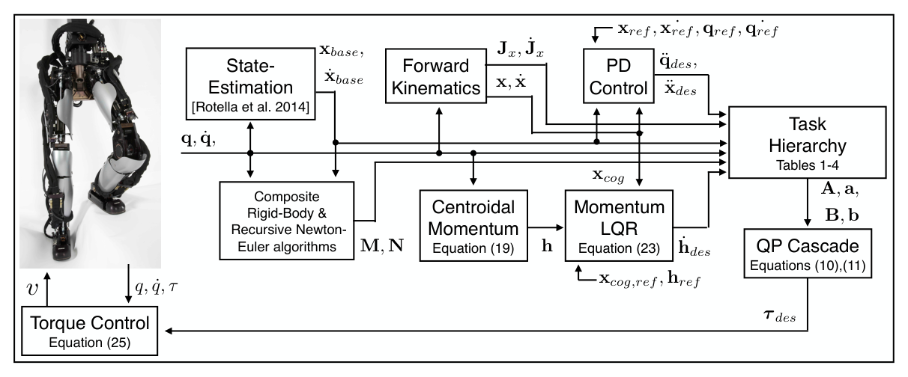

# Momentum Control：面向力矩控制人形机器人的分层逆动力学动量控制

[论文](https://doi.org/10.1007/s10514-015-9476-6)

本文以质心线动量和全身角动量作为力矩控制人形的高层平衡目标，再用层级逆动力学同时求解关节加速度、接触力和力矩，在浮基动力学与接触约束下落实任务优先级。

## 决策变量怎样穿过动力学

控制器根据估计状态、接触集合和任务参考建立一组约束。浮基刚体动力学保证求得的加速度、接触力与关节力矩彼此一致；接触加速度约束让支撑点不随意滑动；摩擦和单边接触限制接触力；力矩与关节约束限制硬件可执行范围。在这些硬约束内，第一层跟踪期望质心/角动量变化，后续层再处理摆动脚、躯干、手和姿态。

决策量由广义加速度、接触力与关节力矩组成，并满足系统动力学约束。输入来自状态估计器、接触计划和各任务参考，输出的关节力矩发送给真实执行器。动量目标通常由质心/姿态误差和期望外力形成，摆动脚与手等局部任务在高优先级动力学和接触可行域内优化。

论文使用层级逆动力学分别求解各优先级任务，避免平衡任务因手部或姿态目标权重过大而被牺牲。求解器需要可靠处理多层可行域；接触计划错误或上层任务本身不可行时，下层任务无法补救。

接触切换是最关键的系统事件：新脚落地前后，约束集合、允许接触力和动量参考都会变化。控制器应依据接触检测修正计划，并对意外提前/延后接触设置过渡；若继续按错误支撑集合求力，优化器可能数学可行但真实脚已经滑动。

> **控制架构图：** Figure 4，PDF第9页。它展示状态估计、运动/动量参考、层级逆动力学和力矩接口怎样闭环。读图时要区分由规划器给出的参考、优化器内部求得的接触量，以及最终发送到真实关节的命令。来源：[原论文](https://doi.org/10.1007/s10514-015-9476-6)。

## 动量控制为什么适合全身任务

质心位置描述平动，却无法单独覆盖上身和四肢甩动带来的角动量；关节姿态也难以直接表达外部接触对整体平衡的影响。Centroidal momentum把质量分布、关节运动和外力统一到一个全身量上，为手臂补偿、受扰恢复和多接触任务提供共同接口。该控制结构不构成完整的稳定性证明：状态估计误差、接触滑移、模型偏差、通信和力矩内环都可能破坏理论闭环。

<!-- research-navigation:start -->
## 相关研究入口

[运动控制与全身行为：模型规划与全身控制](../研究方向_运动控制与全身行为.md#route-model-wbc) · [全部论文与技术报告](README.md)
<!-- research-navigation:end -->
