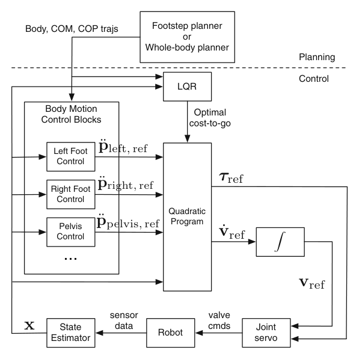

# Atlas Locomotion：面向Atlas人形机器人的优化式运动规划、估计与控制

[论文](https://doi.org/10.1007/s10514-015-9479-3) · [代码](https://github.com/RobotLocomotion/drake)

本文把足步/全身规划、状态估计和反馈控制集成到Atlas的行走闭环中。各模块必须统一坐标系、状态定义、运行频率与延迟，局部算法的性能才会转化为整机运动能力。

## 两类规划器给控制器什么

系统可以由足步规划器先决定接触位置和时序，再生成行走参考；也可以由全身运动规划器处理更复杂的身体与环境约束。规划器输出名义状态和输入轨迹，控制层围绕轨迹使用时变LQR等反馈，根据实时状态偏差修正动作；必要时在线重新计算LQR解，以降低真实机器人偏离名义轨迹后的敏感性。

状态估计与控制在高频闭环运行，融合机器人传感信息并给控制器提供浮基状态。规划线程和控制线程时间尺度不同：前者可以较慢地解决未来接触和轨迹，后者必须持续吸收估计误差与扰动。系统设计的关键是明确每一层消费什么状态、输出什么参考，以及旧计划在新状态下是否仍然有效。

计划接口应包含接触位置/时序、名义状态和控制轨迹以及有效时间窗；估计器输出基座、速度和接触状态；反馈控制器再生成关节执行命令。新估计与名义轨迹偏差超过阈值时，系统应从当前状态重新规划，并按新的计划闭环跟踪。不同线程应使用统一时钟并标记计划版本，防止控制器混用不同版本的数据。

> **系统信号流：** Figure 6，PDF第14页。足步/全身规划器提供期望轨迹，控制器与状态估计器约以800 Hz闭环；LQR可在独立线程根据当前状态重算。图中不同频率和线程比具体模块名称更值得注意。来源：[原论文](https://doi.org/10.1007/s10514-015-9479-3)。

## 作为系统论文的价值

每个模块的误差都会向下游传播：足步计划与实际接触不一致，名义轨迹就失效；估计漂移会让LQR围绕错误状态修正；控制饱和又会让真实状态进一步偏离。一个可运行系统必须提供重规划、状态重置、接触检测、饱和和故障处理，而不能假设所有模块总在设计点。

该工作展示的是特定Atlas系统上的规划、估计与反馈集成，不应外推为现代Atlas版本或优化方法优于学习方法的证据。迁移到其他控制架构时，仍需明确策略替代哪一层，以及状态估计、低层伺服和接触保护由哪些模块承担。

<!-- research-navigation:start -->
## 相关研究入口

[运动控制与全身行为：模型规划与全身控制](../研究方向_运动控制与全身行为.md#route-model-wbc) · [全部论文与技术报告](README.md)
<!-- research-navigation:end -->
