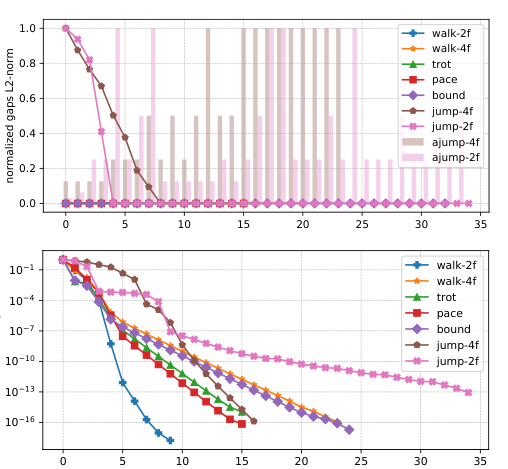

# Crocoddyl：面向多接触最优控制的高效通用框架

[论文](https://arxiv.org/abs/1909.04947) · [项目主页](https://github.com/loco-3d/crocoddyl)

Crocoddyl围绕机器人动力学导数、接触action model和DDP/FDDP求解器构建多接触最优控制框架，使高维非线性系统在接触切换下仍能高效优化可执行轨迹。

## 从shooting到允许“有缝”的轨迹

单重射法只优化控制并从初态一路积分，长时域问题对初值非常敏感；多重射法把中间状态也作为变量，各段轨迹一开始可以不连续，这些不连续就是shooting gaps。求解过程中既降低任务代价，也逐步收紧各段之间的动力学缺口。

每个时间节点的action model定义状态、控制、接触动力学、残差代价和导数；free、contact与impact节点可组成一条完整多接触轨迹。求解器输入初态、接触序列与参考，输出状态和控制序列以及局部反馈增益，将多接触运动组织为可求解的轨迹优化问题。

FDDP的关键策略是不会在第一步就强迫高动态轨迹完全可行。对于跳跃等差初值问题，暂时保留部分gap可以获得更有用的下降方向，随后再把轨迹拉回动力学一致。框架还利用Pinocchio等工具高效计算刚体动力学和解析导数，并用不同action model表示自由运动、不同接触集合与冲击阶段。

Crocoddyl的论文实验报告了给定接触序列下的轨迹优化和收敛结果；没有报告将该优化器作为在线MPC运行，也没有描述超时回退或安全控制器。该框架提供动力学与最优控制求解能力，任务感知和技能选择不属于本文研究内容。

> **关键机制图：** Figure 2，PDF第5页。论文没有一张完整系统总览，这张图直接显示不同动作中shooting gaps、步长和收敛率如何变化。简单步态很快闭合gap，高动态跳跃会在前几次迭代保留缺口，这是FDDP与“每步必须完全可行”直觉的差别。来源：[原论文](https://arxiv.org/abs/1909.04947)。

## 接触序列仍然是上游假设

Crocoddyl擅长在给定模型、代价和接触阶段下优化状态与控制，但它不自动解决开放世界里的接触发现。脚什么时候离地、手何时触物、碰撞模式如何切换，通常仍由任务设计、接触规划或外层搜索提供。错误接触序列可能让优化问题无解，或者得到数学可行但实际不鲁棒的轨迹。

<!-- research-navigation:start -->
## 相关研究入口

[运动控制与全身行为：模型规划与全身控制](../研究方向_运动控制与全身行为.md#route-model-wbc) · [全部论文与技术报告](README.md)
<!-- research-navigation:end -->
