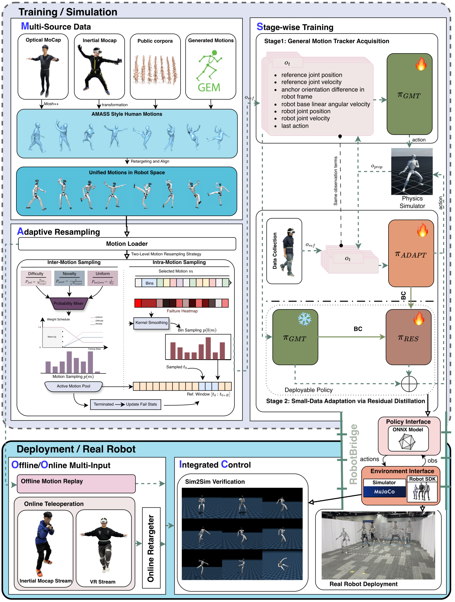

# MOSAIC：通过快速残差适配弥合通用人形动作跟踪与遥操作的Sim2Real差距

[论文](https://arxiv.org/abs/2602.08594) · [项目主页](https://baai-humanoid.github.io/MOSAIC/) · [代码](https://github.com/BAAI-Humanoid/MOSAIC) · [数据集](https://huggingface.co/datasets/BAAI-Humanoid/MOSAIC_Dataset)

离线动作库训练的通用跟踪器接入VR或惯性动捕后，可能因参考动作分布、步态和延迟变化而失稳。MOSAIC先训练通用跟踪策略，再用少量遥操作设备采集的参考动作，在仿真中训练接口专用策略；最后冻结通用策略，蒸馏一个加性残差，把接口适配与原有动作能力结合。输入为参考动作与本体状态，输出仍是关节控制目标。

> **主要方法图：** Figure 2，PDF第4页。多源动作、两级自适应重采样和通用tracker构成第一阶段；接口数据训练适配策略与残差模块，RobotBridge统一离线回放和在线遥操作部署。来源：[原论文](https://arxiv.org/abs/2602.08594)。

## 通用策略先覆盖动作长尾

动作库混合光学mocap、惯性mocap与生成动作。两级adaptive resampling既提高难动作采样，也持续关注当前策略失败片段；面向移动遥操作的奖励强调world-frame一致性，避免机器人局部看似跟上、全局位置和朝向却持续漂移。这个阶段得到覆盖广的general tracker。

## 适配阶段只学习“接口造成的差”

针对PICO VR和惯性动捕，作者采集小规模设备参考动作，分别训练接口专用的适配策略。通用策略和适配策略都使用非对称Actor-Critic与PPO，Critic在训练时可访问特权状态。Actor使用五步可部署观测历史，包含参考关节位置、速度、本体状态与上一动作。这里的小数据主要指遥操作参考动作，并非要求在真实机器人上在线探索和更新残差。

残差蒸馏得到学生策略`πS(o) = πGMT(o) + πRES(o)`，其中通用策略πGMT始终冻结。残差输出层采用接近零的权重增益和零偏置，训练初期尽量维持原有行为。在学生自身rollout上，属于接口适配动作的数据由πADAPT提供监督，属于通用动作库的数据由πGMT提供监督；双教师行为克隆共同约束复合输出。这样，学生既学习接口专用控制，也持续复习原来的运动技能。

## RobotBridge为什么不是附属工程

真实系统还要统一动作格式、时间戳、坐标系、网络通信和安全状态。RobotBridge把离线motion replay、不同可穿戴接口与机器人部署接到同一协议，使算法对比不被各自临时代码污染。对复现者而言，这类部署接口与数据集和模型同样重要。

## 怎样检验通用能力与适配收益

作者先在同样100万帧预算下比较一源、三源和五源动作数据，分析数据多样性对未见动作跟踪的影响；再比较世界坐标与机器人坐标奖励，以及纯RL与DAgger训练。MuJoCo评测使用633段Motion-X-Sub动作，平均时长19.04秒，报告世界坐标下的躯干、身体和末端误差，以及成功率和回合长度。

真实机器人部分展示高动态动作、长时遥操作与不同输入设备的接入。整套流程可按“多源参考训练通用策略 → 设备参考训练适配教师 → 双教师残差蒸馏 → RobotBridge部署”理解。它与使用真实rollout辨识动力学的[ASAP](P033.md)处理不同的适配问题。

<!-- research-navigation:start -->
## 相关研究入口

[运动控制与全身行为：参考跟踪与遥操作](../研究方向_运动控制与全身行为.md#route-reference-tracking-teleop) · [全部论文与技术报告](README.md)
<!-- research-navigation:end -->
