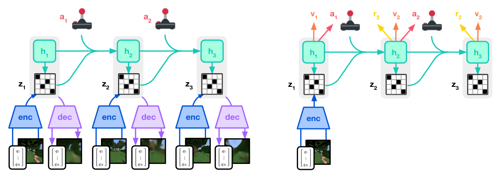

# DreamerV3：基于世界模型的跨领域通用控制

[论文](https://arxiv.org/abs/2301.04104) · [代码](https://github.com/danijar/dreamerv3)

DreamerV3延续“RSSM + 潜空间actor-critic”，并将多项稳定化方法发展为核心贡献，以同一配置处理视觉像素、低维状态、连续/离散动作及密集/稀疏奖励。“通用”指算法数值鲁棒性可跨控制与游戏领域使用；各机器人仍需自己的物理模型、观测和动作接口。

> **主要方法图：** Figure 3，PDF第3页。世界模型用离散z和递归h建模观测、奖励与继续信号；actor和critic只在抽象潜轨迹上学动作与价值。来源：[原论文](https://arxiv.org/abs/2301.04104)。

## 世界模型的表示为什么改成离散z

编码器把观测映射为多个类别变量，RSSM由历史h和动作预测这些离散z的先验，观测编码器给后验。训练同时包含重建/预测损失、先验追后验的dynamics KL和后验靠近先验的representation KL，通过stop-gradient分别更新两边。Free bits避免KL把表示压空，1% uniform mixture避免类别分布过早变得确定，这些都是让潜想象可长期训练的必要稳定器。

模型还预测奖励和episode继续信号，后者让想象轨迹知道何时应终止。执行时真实观测持续更新后验belief，actor从当前潜状态直接输出动作；训练时actor和critic则在RSSM想象轨迹上用lambda return优化。V3没有提供语言任务规划或跨episode记忆；“跨领域”指同一算法配置适配不同环境，机器人策略仍针对各自任务和接口训练。

## Symlog和Two-hot在解决什么

不同任务的状态、奖励和回报可差几个数量级。Symlog在零附近近似线性，对大的正负值做对数压缩，使同一网络和学习率能处理不同尺度。奖励头和critic使用symexp刻度的two-hot分布损失，在桶上用相邻两个非零权重表示连续目标。Actor则用批内回报的5%到95%分位区间做平滑归一化，让固定熵系数在各任务上意义相近。

这些稳定器提高优化鲁棒性，无法修复现实接触模型。人形应用仍需定义视觉/本体观测、动作接口和奖励，并让低层控制器处理关节限位、平衡与碰撞。更现实的组合是世界模型在技能或短时运动参考层学习结果，再通过真机数据回流校准；全身动作的在线探索仍需安全保护。

## 钻石结果与机器人世界模型之间还隔着什么

DreamerV3以同一超参数配置覆盖150多个任务，并在无人类数据和curriculum的Minecraft环境中从像素学会获取钻石。这强有力地证明了稳定的潜想象能处理长时稀疏奖励；论文没有提供真机、传感器漂移、未建模接触或安全下线的证据。将V3用于人形需处理现实数据成本、模型偏差、离线预训练与安全的真机探索，不能只替换环境API。

<!-- research-navigation:start -->
## 相关研究入口

[世界模型与通用动作策略：状态潜空间世界模型](../研究方向_世界模型与通用动作策略.md#route-latent-state-world-models) · [全部论文与技术报告](README.md)
<!-- research-navigation:end -->
