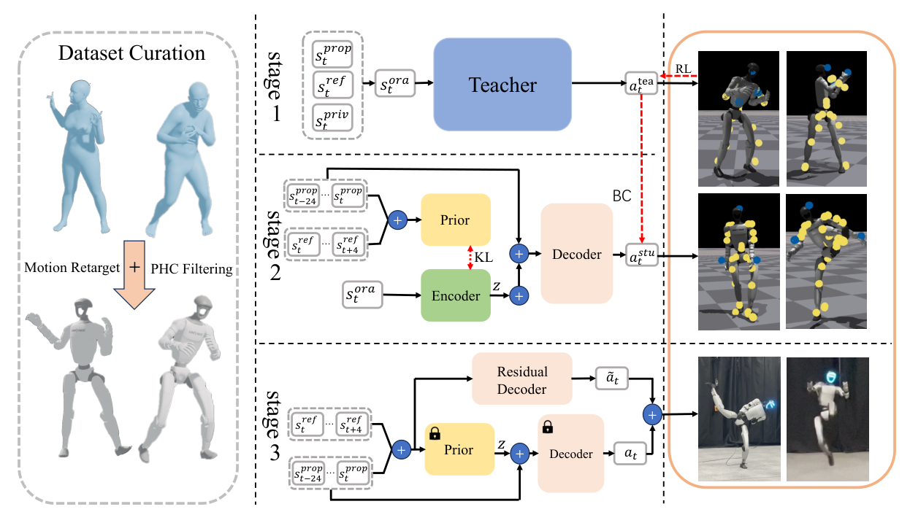

# UniTracker：面向人形机器人的通用全身动作跟踪器

[论文](https://arxiv.org/abs/2507.07356) · [项目主页](https://yinkangning0124.github.io/Humanoid-UniTracker/)

训练一个“覆盖所有动作”的跟踪器有两个不同问题：其一，仿真教师能看到完整根状态，但真机只能依赖部分观测；其二，即使完成蒸馏，少量快速、倒地或强耦合动作仍可能被统一策略平均掉。UniTracker将训练拆成特权教师、CVAE-DAgger蒸馏和残差适配三阶段，分别处理观测差异与困难动作覆盖。

> **主要方法图：** Figure 2，PDF第3页。左侧动作先经重定向和PHC可行性过滤，然后进入高质量特权教师；中间用CVAE与DAgger把教师动作蒸馏到部署观测；右侧在通用策略上增加轻量残差解码器，处理仍然失败的高动态参考。来源：[原论文](https://arxiv.org/abs/2507.07356)。

## 论文框架：特权教师、部分观测蒸馏和困难动作适配

动作数据来自AMASS。系统先排除人体—物体交互和过短片段，再用PHC规则过滤不适合物理执行的序列，最终保留8179段动作。人体动作通过16个人机对应身体做两步重定向：先调整SMPL体型使静态肢体比例接近G1，再逐帧优化机器人根位移、根旋转和关节角，并用正则项抑制激进变化和时间抖动。因此后续策略跟踪机器人参考，SMPL角度只用于重定向过程。

oracle教师用goal-conditioned PPO训练，能读取仿真中每个刚体的位置、方向、线速度和角速度，以及关节状态与上一动作。目标是当前状态与下一帧参考的局部差值。这种输入让教师可以直接看到哪个身体偏离了多少，用关键点、足位置、身体旋转、关节位置与速度、身体线/角速度跟踪奖励建立动作质量上限。动作变化率、力矩和足滑惩罚随课程逐步加入，避免训练初期在还不会跟踪时就被强正则压制。

策略输出23维目标关节位置，经PD执行。原始G1配置中的部分手腕自由度在实验设置中固定，因此不能把“23维策略”直接当成所有G1全身配置的统一接口。第一阶段追求的是运动质量上限，不等于已经可以无修改部署。

## CVAE保存被遮挡的运动意图

第二阶段的关键困难是部分观测会丢掉全局平移、朝向和未来趋势。UniTracker用条件VAE做教师—学生对齐：训练时，encoder看到完整观测，prior只看到部署时可获得的部分观测；KL约束让两者潜变量分布靠近，decoder再由潜变量和当前状态产生动作。论文报告64维latent取得较好折中。

教师数据通过DAgger在学生自身状态分布中迭代采集：学生滚动执行，教师为到达状态提供纠正动作，以减少偏离后的误差扩散。训练时的CVAE encoder读取与教师相同的完整观测，让潜变量保留全局运动意图；conditional prior只读取真机可得的25步本体历史和5步未来参考，KL损失迫使它逼近encoder的潜分布。decoder再用潜变量和当前可部署观测输出23维关节目标，动作重建损失直接对齐教师动作。

真机部署时，特权状态encoder和oracle教师退出，只保留conditional prior和action decoder。prior从部分观测估计64维潜在运动意图，decoder将它转为关节位置目标，PD控制器再驱动G1。latent用于从当前部分观测推断如何延续运动意图；它不承担上层语言动作token的语义接口。论文未明确披露真机策略与PD的运行频率，不应根据相邻工作补写。

## 第三阶段到底算不算“快速适配”

对统一策略仍跟不住的动作，作者冻结通用prior和decoder，只用与部署策略相同的本体与参考输入训练一个残差decoder。该decoder读取部署本体和参考输入，对固定通用动作增加关节目标修正，并使用与教师阶段相同的跟踪奖励做强化学习。它能在较少更新中补偿特定困难序列，比从头训练一个专用策略快，同时冻结主体避免原有大范围能力被新序列覆写。

这里的适配针对选定困难序列或小批运动继续优化；论文没有证明策略能够对任意新动作零样本完成。真实部署仍需要参考动作、状态估计、关节PD和本体安全层。论文在Unitree G1上展示仿真与真机动作跟踪，并声称覆盖大规模动作集。

UniTracker输出的是G1全身参考跟踪行为。PHC过滤位于上游，CVAE蒸馏与残差适配属于tracker训练；新动作的适配仍需参考输入和针对困难序列的更新。

<!-- research-navigation:start -->
## 相关研究入口

[运动控制与全身行为](../研究方向_运动控制与全身行为.md) · [全部论文与技术报告](README.md)
<!-- research-navigation:end -->
