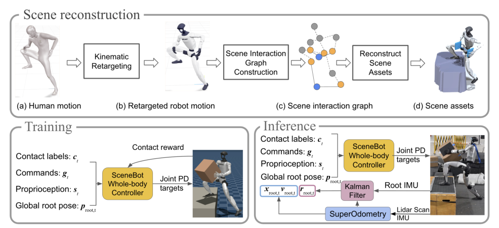

# SceneBot：接触提示的场景交互人形全身跟踪

[论文](https://arxiv.org/abs/2606.27581) · [项目主页](https://ericcsr.github.io/scenebot/)

普通motion tracking只告诉机器人身体应到什么姿态，却没有说明脚应踩台阶还是跨过去、手是经过箱子旁边还是要把它托住。仅凭人体运动学轨迹，场景接触存在多解。SceneBot从人—场景运动中恢复接触关系，把接触标签作为prompt交给全身跟踪策略，使同一控制器既能处理地形支撑，也能处理搬箱等物体交互。

> **主要方法图：** Figure 2，PDF第4页。流程从重定向运动建立机器人—场景交互图，反推地形与物体，再用动作和接触共同训练；真机侧依赖SuperOdometry与IMU提供根状态。来源：[原论文](https://arxiv.org/abs/2606.27581)。

## 从运动数据重建交互场景

数据来源包括AMASS、OMOMO、BEHAVE/Bones类交互数据和LAFAN等人体运动。人体动作先重定向到机器人，再根据手腕、脚、骨盆与候选场景节点之间的相对距离、速度、加速度和时间连续性，建立robot-scene interaction graph。持续接近且相对运动一致的部位被判断为可能接触。

场景随后按接触关系重建：脚部接触可形成2.5D高度地形，手部和身体接触可放置板状或箱状物体。重建目标是构造能解释动作接触的物理训练环境，输出“动作参考 + 接触提示 + 可交互资产”；它不提供原始场景的精确三维复原。

## 接触prompt怎样进入控制器

策略输入当前接触标签、参考命令、本体状态和根状态。参考中包含下肢目标关节/速度、头部与手腕在根坐标系下的目标位姿，以及全局根误差；本体观测包含关节位置/速度、投影重力和根角速度等。策略输出关节动作并通过低层控制执行。

奖励同时追踪动作，并按接触prompt检查指定身体部位是否在正确场景位置形成接触，从而区分“姿态很像但脚悬空”和“手经过箱子但没托住”。接触标签由条件输入提供；任务计划仍需由上层系统决定，包括何时携物、在哪里踩踏以及何时切换动作。

## 真机观测与传感器配置

SceneBot真机部署在Unitree G1上，论文展示复杂地形通过和携箱场景，并报告约7.5小时动作数据。为了计算全局根误差和场景相对位置，系统使用SuperOdometry与机载LiDAR/IMU估计根位置、朝向和线速度。若定位漂移或场景几何与重建训练环境差别过大，接触prompt再准确也可能指向错误位置。

场景资产与接触模型采用简化重建，高层仍需提供接触标签；动态物体和精细手部接触未被统一建模。接触标签误差或全局定位漂移会使策略把正确的动作参考施加到错误场景位置。

<!-- research-navigation:start -->
## 相关研究入口

[物体交互与全身操作](../研究方向_物体交互与全身操作.md) · [全部论文与技术报告](README.md)
<!-- research-navigation:end -->
