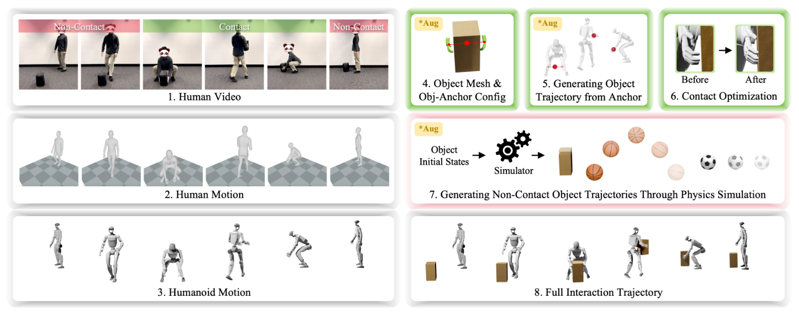

# HumanX：基于人类视频的敏捷可泛化人形交互技能

[论文](https://arxiv.org/abs/2602.02473) · [项目主页](https://wyhuai.github.io/human-x/) · [代码](https://github.com/wyhuai/HumanX)

人形机器人模仿普通舞蹈时，参考里只有身体；模仿投篮、接球或搬箱时，参考还必须说明物体何时接触、接触在哪里、离手后怎样运动。HumanX的价值在于把一段单目人类视频拆成可编辑的数据生成过程，再用统一的XMimic训练交互策略。它解决的首先是交互数据入口，而不是发明一个只服务篮球的任务奖励。

> **主要方法图：** Figure 2，PDF第3页。图中XGen从人类视频恢复SMPL动作并重定向到机器人，再分别处理接触段与非接触段，最后拼出完整交互轨迹。来源：[原论文](https://arxiv.org/abs/2602.02473)。

## XGen怎样把视频变成“可训练的数据”

第一步是从单目视频恢复人体动作，再按G1形态做重定向。关键变化发生在物体侧：作者先把视频切成接触与非接触阶段。接触阶段选一个人体锚点，例如双掌中点，估计物体网格及其相对锚点的位姿；锚点随人体运动后便得到物体参考轨迹，再用force-closure/contact optimization修正机器人姿态，使手和物体的接触在几何上更可信。

非接触阶段不能简单复制视频中的抛物线，因为单目估计误差会直接污染训练。XGen把初始物体状态放入物理仿真，让重力、碰撞和初速度生成轨迹。物体尺寸、网格、初态和飞行轨迹都能增广，接触段与非接触段经过插值后组成完整样本。这样，一段示范不再只对应一条固定轨迹，而能扩成一簇保留交互结构的训练分布。

## XMimic学的是交互，不是逐帧背动作

XMimic先训练读取特权身体与物体状态的teacher，再把多个teacher蒸馏到可部署student。student只保留本体感知和可选物体观测，目标由PPO与behavior cloning共同构成。统一奖励同时约束身体、物体、身体与物体的相对关系、接触和动作正则，其中身体自然度还使用AMP项。

## G1交互技能与实验

策略输出全身关节目标。部署实验采用本体历史输入和加入MoCap物体位姿的两种配置，分别展示无外部感知的动作技能与带实时物体状态的自主交互。训练时模拟物体观测丢帧，使策略能够应对观测变化。

官方项目在Unitree G1上展示篮球、足球、羽毛球、货物拾取和反应式格斗五类任务、10种技能，包括假动作后转身后仰跳投，以及从单段视频学习的连续10轮人机传接球。不同演示使用对应的感知配置；传接球等需要实时物体状态的实验，与无外部感知的动作演示分别呈现。

## 从视频到训练实现

[官方代码](https://github.com/wyhuai/HumanX)将XGen编辑与数据处理、XMimic仿真训练分开组织。视频先经GVHMR恢复世界坐标人体运动，再经UMR重定向到G1；XGen编辑机器人与物体交互并导出HOI `.npz`，XMimic将其转换为训练使用的 `.pkl`。仓库给出篮球接抛、假动作投篮、足球踢球和箱体取放样例，并提供训练、评测、格式转换和动作回放入口。
