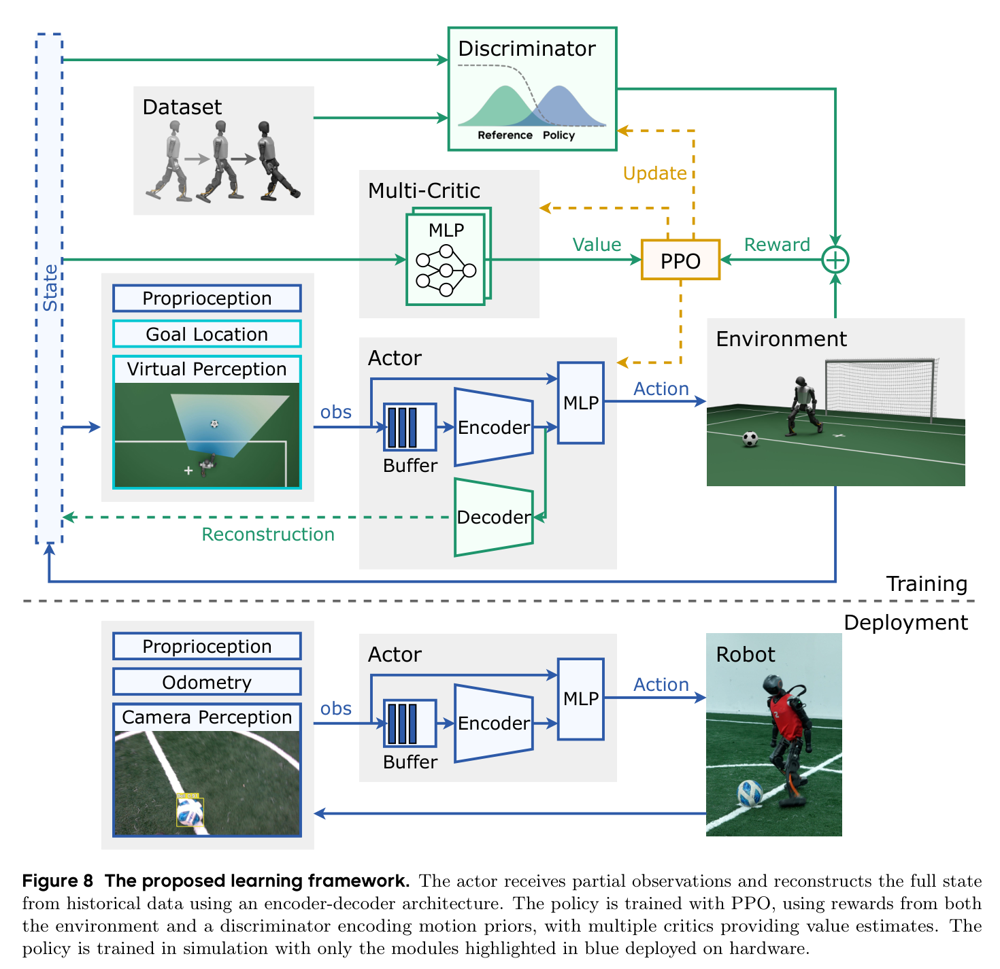

# Vision-Driven Soccer：把不可靠视觉接入人形机器人反应式全身控制

[论文](https://arxiv.org/abs/2511.03996) · [项目主页](https://humanoid-kick.github.io/) · [代码](https://doi.org/10.5281/zenodo.21620490) · [Science Robotics正式期刊版本](https://www.science.org/doi/10.1126/scirobotics.aed1152) · [Dryad实验数据与复现说明](https://doi.org/10.5061/dryad.jwstqjqps) · [清华大学自动化系团队介绍](https://www.au.tsinghua.edu.cn/info/1062/4568.htm)

人形机器人踢球需要同时移动头部维持目标可见，并依据球和球门变化调整步态、接近方向、支撑脚与触球动作。相机还会带来延迟、掉检、运动模糊和距离相关误差；检测、定位、行走与踢球若由多个模块顺序执行，过期结果会逐级传播。该工作因此将视觉观测与运动控制放入反应式闭环，以适应动态场景。

这项工作把足球任务建模为部分可观测控制问题。系统先将机载视觉压缩为球与球门相关的结构化观测，再在仿真中复现真实视觉的噪声、视野、更新频率和延迟。策略从一秒历史观测中估计被遮挡或不可直接测量的状态，并输出全身关节位置目标，由PD控制器在真机执行。

论文于2026年发表于 **Science Robotics，第11卷第117期，文章号eaed1152**。arXiv是同一工作的开放预印本，不作为第二篇论文重复统计。

## 完整实现链路

```text
头部Intel RealSense D435i相机
      ↓
YOLO检测球、球门柱、罚球点与场地交点
      ↓
深度投影 + 几何投影 → 机器人坐标系BEV观测（25 Hz）
      ├── 球位置 + 是否检测到球
      └── 场地地标 → 粒子滤波修正本体里程计 → 球门位置与方向
                              ↓
本体状态 + 当前结构化视觉观测 + 最近50帧观测历史
                              ↓
                     历史观测编码器
                              ↓
          64维隐变量 + 当前观测 → Actor MLP
                   ↓                    ↓
       训练期Decoder重建特权状态       关节位置目标（50 Hz）
                                            ↓
                                      PD控制与真机执行
                                            ↓
                       新的身体状态、相机视角与球场变化
```

训练策略的另一条信号流是：

```text
任务奖励：进球、接近球、让球接近球门
运动先验：人类行走与足弓踢球动作 → AMP判别器风格奖励
正则与安全：关节限制、碰撞、动作变化、对称性
                              ↓
                    两组Critic分别估值
                              ↓
                         PPO更新Actor
```



图8把训练与部署的边界画得很清楚：特权状态、Decoder、判别器和多Critic只服务训练；真机只保留历史Buffer、Encoder与Actor。图源：[论文开放全文](https://arxiv.org/abs/2511.03996)。

## 视觉怎样变成策略观测

真机使用安装在头部两自由度云台上的Intel RealSense D435i。论文报告使用YOLOv8，并以机载相机自采数据微调，检测足球和场地地标；文中没有给出YOLOv8具体变体或训练图像数量。检测结果结合深度和相机姿态投影到鸟瞰坐标系，Actor接收机器人坐标系中的球位置、球检测标记、球门中心和球门法向等结构化量。

这种对象中心表示保留足球任务需要的几何量，并舍弃纹理、颜色和背景，降低合成图像与真实画面的视觉差距。系统依赖外部检测器、相机标定、深度投影和场地地标定义；论文验证的是结构化视觉观测与运动策略的联合闭环。

球位置直接送入策略。球门位置则依赖混合里程计：一个MLP从最近一秒的关节、本体姿态、角速度、前一动作和前一里程计输出估计短时位移；场地地标检测再通过粒子滤波周期性修正累计漂移。视觉修正失败时，系统退回本体里程计继续运行。

## 为什么要在仿真中重建真实视觉缺陷

若训练时Actor始终读取球的真值位置，部署时突然换成带噪检测结果，策略会把误差当作真实运动并产生错误动作。作者先用默认步态控制机器人、由人工移动足球，结合动捕真值采集约一小时感知数据，再拟合四类虚拟感知特性：

- 球越远，位置噪声越大；
- 感知延迟按均值116毫秒、标准差18毫秒建模，更新频率按均值25.36 Hz、标准差1.06 Hz建模；控制策略运行在50 Hz；
- 球在机器人视场内且距离不超过7米时，检测概率设为90%，更远时逐渐下降。

训练时Actor看到的是经过这些退化后的球观测，而Critic和Decoder仍可以读取仿真真值。策略因此必须学会在检测间隔、短时遮挡和观测跳变中保持动作连续，并通过主动转头和身体调整让球重新进入视野。

## 历史编码与状态重建解决什么

Actor除当前观测外还读取最近50帧、约一秒的历史，并把它们压缩成64维隐变量。训练期Decoder从该隐变量重建球的真实位置、机器人动力学参数等部署时难以直接获得的信息；Decoder仅承担辅助监督，促使Encoder在历史中保留能够解释当前带噪观测的状态信息，不参与部署时的显式球状态估计。

论文的消融显示，把Decoder从联合训练中移除并在事后从冻结隐变量预测球位置时，估计误差基本停留在感知噪声水平。辅助重建目标与策略学习共同塑造了更有效的状态估计能力。

## AMP怎样进入足球策略

任务奖励可以鼓励机器人靠近球并把球送入球门，却不能保证动作自然、触球位置稳定或左右脚都能使用。作者使用76.28秒全方向行走动作和30秒足弓踢球动作，经优化式重定向得到机器人参考数据，再用Wasserstein GAN形式的AMP判别器比较参考动作与策略动作的相邻状态转移。

判别器输出形成风格奖励，与进球、接近球、球门推进等奖励共同训练PPO。镜像对称损失约束左右状态与动作的一致性，帮助策略学习双侧踢球能力。AMP提供动作分布约束，部署Actor据此自由组合搜球、接近、转向、调整支撑和触球动作。

## 多Critic为什么必要

进球奖励稀疏且不连续，动作风格、正则和安全奖励却每一步都存在。若所有奖励共享一个Critic，进球事件造成的高方差会干扰其他价值估计。论文把进球、接近球和球门推进放入目标Critic，把风格与正则项放入辅助Critic，分别估计并归一化优势后再合并更新Actor。

这项设计缓解异质奖励之间的估值干扰。部署时由单个Actor输出统一的全身关节位置目标。

## 训练与真机部署

策略在Isaac Gym中使用16384个并行环境和8张V100训练约一天。训练随机化覆盖关节控制延迟、电机偏置、刚度与阻尼、身体质量和质心、足地摩擦与恢复系数，以及足球质量、摩擦和碰撞恢复；球还会被随机施加速度或传送，机器人会受到外力和额外速度扰动，以模拟比赛中的动态变化。

真机为约1.2米、30千克的Booster T1，硬件本体没有为论文做专门改造。Jetson AGX Orin以约25 Hz运行视觉检测与BEV投影，Actor以50 Hz输出期望关节位置，底层PD控制器跟踪这些目标。策略完全在仿真训练并零样本部署，论文没有进行真机在线强化学习。

## 实验证明了什么

作者报告的主要结果包括：

- 项目页报告前场位置的射门成功率约为90%。论文称随着球距球门增加或射门方向偏离球门法向，成功率会下降；后场角度偏差超过±10°时容易射偏。真机成功率与仿真相近，测试未记录摔倒；
- 踢球前一秒的球位置估计均方根误差从0.344米降至0.186米，约降低46%；
- 与规则式基线比较时，机器人从距球1.5米处开始，每个接近方向测试5次；规则策略朝向球门时约2秒踢出球，目标在身后时约5秒，学习策略在所有测试朝向下用时更短。项目页报告相较规则基线的踢球时间最高缩短64%，正文没有列出学习策略各方向的绝对用时；
- 学习策略在所有测试朝向下的转向速度高于规则基线，并形成搜球、追球、左右脚多方向踢球和短时遮挡后的恢复行为；
- 策略在草地、石板、土壤、沥青和橡胶等环境中完成零样本实机测试，并作为清华火神队系统模块参加真实RoboCup比赛。

这些证据支持的核心结论是：把真实感知的不确定性放进运动策略训练，比使用理想球位或固定规则串联感知与动作更适合动态足球闭环。

## 比赛系统与策略分工

比赛系统由感知、单机器人运动策略和团队行为编排组成。YOLO检测器识别球与球场地标并提供结构化视觉观测；单机器人Actor根据本体状态和最近一秒的观测历史输出全身关节位置目标，部署平台为Booster T1。高层行为树处理比赛规则、角色分配、多机器人协同与策略启停；机器人离球较远或未满足触发条件时，由独立的速度跟踪行走控制器负责移动，主要进攻机器人进入指定空间范围后切换到学习策略。

论文的真机踢球、球位估计、触球时间和扰动恢复结果评估这套视觉驱动运动策略。RoboCup赛事中的76个进球和冠军成绩属于清华火神队完整团队系统的表现，其中还包括行为树、多机器人协作、YOLO感知和独立行走控制器的贡献。单机器人策略以结构化球场视觉量控制Booster T1，赛事结果对应整队系统，二者的评测对象和归属范围各自明确。

<!-- research-navigation:start -->
## 相关研究入口

[运动控制与全身行为](../研究方向_运动控制与全身行为.md) · [全部论文与技术报告](README.md)
<!-- research-navigation:end -->
