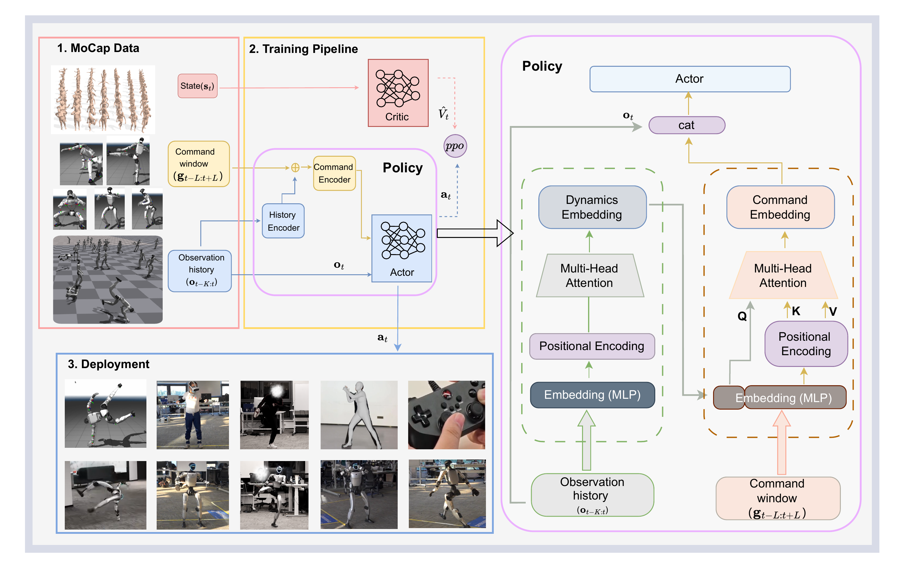

# RGMT：根据机器人当前动力学状态选择可执行参考

[论文](https://arxiv.org/abs/2601.23080) · [项目主页](https://zeonsunlightyu.github.io/RGMT.github.io/)

动作跟踪器通常把未来若干帧参考直接交给策略，但重定向后的参考可能不连续、不准确或不符合目标机器人的动力学。高速转身、倒地起身、拳击和接触动作中，脚滑、根节点漂移或关节突变可能被闭环执行放大，令机器人偏离参考甚至跌倒。RGMT让策略先估计当前动力学状态，再从参考窗口中提取当前有用的命令。

> **主要方法图：** 官方项目页Training Method。左侧展示动作数据、PPO训练和真机部署，右侧展开策略内部的历史编码与命令聚合。来源：[官方项目页](https://zeonsunlightyu.github.io/RGMT.github.io/)。

## 本体历史先形成当前动力学摘要

每个控制周期，机器人读取近期关节位置、关节速度、基座姿态和上一动作等本体历史。因果历史编码器只用当前与过去信息，把序列压成动力学嵌入，概括机器人运动方向、支撑状态、上一条命令的响应，以及当前状态与参考之间的偏差变化。

这样处理后，相同参考帧可根据不同身体状态产生不同响应。例如，机器人因碰撞向后倾时，策略可结合历史趋势提前减小后仰命令；机器人处于腾空或落地阶段时，策略结合真实身体响应与单帧姿态确定下一步跟踪重点。历史编码器承担状态估计和短时动力学概括，动作仍由在线跟踪策略生成。

## 动力学摘要再从参考窗口中聚合命令

系统同时读取目标时刻前后的一段参考窗口。命令编码器使用多头跨注意力，以当前动力学嵌入为查询，将窗口内经位置编码的参考帧作为候选信息。策略根据当前身体状态为不同时间位置和身体变化分配权重，形成聚合后的命令嵌入。

这一步适合处理两类失配。第一类是时间失配，例如真实机器人落地比参考晚半拍，固定索引会继续推进动作，而聚合窗口可以保留更相关的落地命令。第二类是局部参考缺陷，例如某帧重定向结果突变，窗口内相邻帧仍可提供连续趋势。命令聚合在输入窗口内筛选和组合参考信息；上游参考整体不可执行时，策略仍缺少可跟踪目标。

当前观测、动力学嵌入和命令嵌入最后拼接给Actor，输出全身关节动作。训练期Critic读取更完整的动作状态并通过PPO更新策略；部署时保留历史编码器、命令编码器和Actor，持续用真实本体反馈闭环修正。论文采用单阶段端到端训练，没有先训练教师再蒸馏学生。

## 跌倒恢复课程补足参考跟踪之外的状态

普通动作数据很少覆盖已经明显失稳或倒地后的状态，只从正常参考初始化时，策略即使平均跟踪误差很低，也可能在一次碰撞后完全不知道怎样恢复。RGMT在训练中随机生成不稳定初始姿态，并在课程早期施加向上的辅助力，让策略先学会从较容易的失稳状态重新站稳；随着训练推进，辅助力逐渐减弱，恢复动作必须更多依赖策略自身完成。

恢复课程与命令聚合解决不同问题。命令聚合降低噪声参考和时序偏差造成的持续漂移，恢复课程扩大策略见过的失败状态范围。机器人恢复后重新接回参考，两者共同构成“跟踪、失配、恢复、继续跟踪”的闭环，并由同一策略完成恢复与后续跟踪。

## 实验结果与技术边界

作者报告使用约3.5小时筛选后的动作数据完成训练，并展示动作回放、未见动作、体育与地面接触动作、VR遥操作、手柄移动、外力扰动和跌倒恢复。该训练集由LAFAN1与AMASS子集经过人体动作质量筛选构建；面向人形机器人的有效数据准备仍包含运动恢复、重定向、接触处理和序列清理。

项目没有证明任意噪声参考都可被吸收；系统仍需要目标本体可行的动作分布和稳定的底层执行接口。

## 与Extreme-RGMT的关系

RGMT在单次闭环执行中通过本体历史编码、动态条件参考聚合与跌倒恢复课程处理噪声、时序失配、扰动和倒地状态。后续[Extreme-RGMT](P153.md)围绕技能集合扩展，使用困难片段采样处理空翻等稀有高动态技能，并控制旧技能退化。两者分别改进执行期鲁棒性与持续训练中的样本分配。

<!-- research-navigation:start -->
## 相关研究入口

[运动控制与全身行为](../研究方向_运动控制与全身行为.md) · [全部论文与技术报告](README.md)
<!-- research-navigation:end -->
