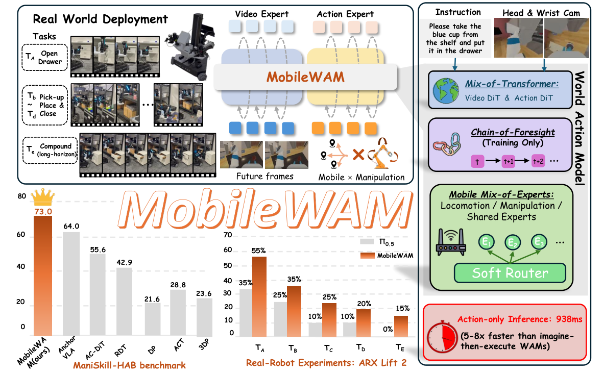

# MobileWAM：用训练期未来信念支持移动操作

[论文](https://arxiv.org/abs/2608.04657) · [arXiv HTML 正文与 Figure 1](https://arxiv.org/html/2608.04657v2)

> 论文原图：视频专家与动作专家的联合注意力、训练期 Chain-of-Foresight，以及面向移动操作的 Mobile MoE。

## 核心问题

MobileWAM研究World Action Model的视频预测能力如何服务移动操作。底盘移动会改变观察视角，机械臂和底盘也有不同的动作尺度；视频专家与动作专家分离时，未来视觉表示难以直接影响当前动作，推理时完整生成未来视频则会增加控制延迟。论文在多层联合处理视频token与动作token，训练期加入Chain-of-Foresight，让模型递归传递未来信念，并用Mobile Mixture-of-Experts将共享、移动和操作因素分路由。

## 输入、输出与结构

WAM输入语言、两路相机的当前视觉和带噪动作块，视频专家使用3D VAE潜变量，动作专家把机器人状态加入文本条件。视频主干为30层、宽度3072的扩散Transformer；一个视频潜变量时间点对应一个动作块，当前帧为干净latent、未来帧为带噪latent。动作专家宽度约1024，在全部30层与视频token进行lockstep shared self-attention，输出长度H=4的动作块。视觉未来与动作去噪通过这一接口在同层交流。

Mobile MoE用共享expert、locomotion expert和manipulation expert替换前馈层，由带噪动作嵌入的均值经soft router生成权重；零初始化有助于从原有WAM行为平稳适配。CoF从第4、12、20、30层抽取中间表示，用两层MLP/Transformer风格的递归链让下一次未来latent条件化于前一次belief。CoF只用于训练辅助。部署时只编码当前帧并缓存一次视觉条件，移除未来视频生成和CoF递归，直接运行动作专家；论文约938 ms测量的是action-only policy inference，不包含相机、控制器和执行器的完整系统延迟。

## 训练与推理

论文在 ManiSkill-HAB RGB-only 任务上做单阶段训练，并将 Mobile MoE 与 CoF 一起加入 WAM 的视频/动作学习目标。CoF 的价值在于给动作专家提供训练期的长时域信念约束，推理时不需要显式未来帧，因此它和“在线想象多步视频”的世界模型规划器不同。输入仍然需要相机视角、语言、状态和动作噪声符合预训练接口；移动底盘的速度约束、机械臂限位和稳定控制仍由机器人执行层负责。

真机平台是 ARX Lift2，论文用逐步增加任务时域的移动操作任务检验长程效果；仿真平均成功率为 73.0%，图中还对比了 pi0.5 在真实任务上的趋势。仿真消融在有限 5,000 步预算下，原始 WAM 平均成功率为 50.2%，并行未来为 52.3%，简单 MLP CoF 为 46.3%，递归 Transformer CoF 为 58.2%，说明 CoF 的结构和训练预算都影响结果，不能只把“有 foresight”当成充分解释。论文还报告 action-only 推理比 generate-then-act 的 WAM 方案快约 5 到 8 倍。

## 实验边界

ManiSkill-HAB是RGB-only仿真基准，真机证据集中在ARX Lift2及论文列出的任务；人形全身控制、复杂接触和无标定相机尚未纳入评测。Mobile MoE属于动作专家的表示与路由结构，底盘平衡、足端接触和全身控制仍由其他控制模块负责。部署移除CoF递归后，收益来自训练得到的参数；复现若保留该递归链，延迟与资源条件会随之变化。

ARX Lift2 的真实成功率图适合做相对趋势参考，但在采用前应重新取得任务定义、成功判据和每项试验分母。尤其要把策略推理 938 ms、控制周期、相机采集、动作块执行和恢复时间分列记录。

<!-- research-navigation:start -->
## 相关研究入口

[物体交互与全身操作](../研究方向_物体交互与全身操作.md) · [全部论文与技术报告](README.md)
<!-- research-navigation:end -->
