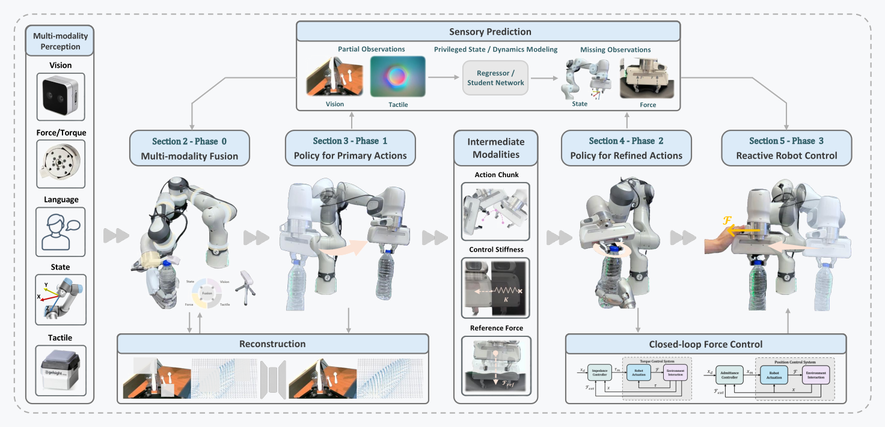

# TF-ART：把触觉、力觉学习拆成可核验的闭环

[论文](https://arxiv.org/abs/2608.07558) · [项目主页](https://lorenzo-0-0.github.io/tactile-force-survey/) · [官方综述资源清单](https://github.com/NTUMARS/Awesome-Tactile-Force-aware-Robot-Learning)

> 本页的子类是“接触力控与负载适应”。综述沿传感器、表示、动作生成、动作修正和机器人末端控制等环节，比较触觉/力觉机器人学习系统各自承担的功能。

TF-ART（Tactile- and Force-Aware Robot learning Taxonomy）是一篇综述。它把触觉、力/力矩、视觉、语言、本体状态等输入放进多模态、多阶段框架，并显式说明从高层策略到低层反应控制的接口。知识库将它归入LocoManip与物理交互，定位为研究分类与比较框架。综述整理了53篇代表性工作，各工作保留自身策略和训练方案。

## 核心图：从接触观测到末端控制

> **主要方法图：** 官方项目页的overview，展示多模态感知、传感器预测、融合、主动作生成、动作修正和反应式机器人末端控制。来源：[官方overview图](https://lorenzo-0-0.github.io/tactile-force-survey/assets/images/teaser.png)。该图概括综述框架中的系统环节。

它所要解决的痛点是研究之间的“接口不可比”。一项工作可能用腕部六轴力/力矩传感器预测末端轨迹，另一项用触觉图像修正抓取动作，第三项直接把参考力送进阻抗控制；如果只比较模型名称或成功率，就无法知道差异来自感知、融合、策略还是低层控制。TF-ART 采用 Phase 0 到 Phase 3 的顺序，把一条接触闭环拆开，使读者能够沿着信号流追踪信息在哪里被压缩、补全或交给控制器。

## 输入、表示与输出

输入侧不仅有 RGB 或深度图，还包括语言、关节/末端状态、腕部或关节力矩、外部六轴力/力矩和触觉图像。综述区分静态接触/压力分布、滑动或探索产生的动态触觉，以及负载、接触方向和环境反力等力觉信号。工程上需要同时记录传感器坐标系、采样频率、时间戳、滤波延迟、零点漂移和接触事件；否则“融合”可能只是把不同步的信号拼到一个张量里。

Phase 0 负责多模态表示与融合，也包括从部分观测重建缺失模态、从 privileged state 或动力学模型蒸馏传感器线索。Phase 1 是主动作生成，可输出末端位姿、关节动作、动作块、抓取参数或技能条件。中间模态包括 action chunk、控制刚度和参考力。Phase 2 以当前接触和力觉反馈对主动作做残差、重规划或方向修正。Phase 3 才是反应式机器人末端控制，常见实现包括位置/力混合控制、阻抗、导纳、PD 或 PID。因而“策略预测了力”与“机器人闭环施加了稳定的力”是两个不同的证据层级。

## 训练、推理与实验口径

TF-ART归纳监督模仿、表示学习、缺失模态预测、特权状态蒸馏、动作生成与控制器耦合等训练和推理配方；具体论文可能覆盖其中一个阶段，也可能把学习策略与解析阻抗/导纳控制串联。综述证据来自文献与任务基础设施的横向整理，各论文使用的机器人、轨迹和传感器标定条件不同。框图展示系统接口，不定义统一输入维度、控制频率或成功率。

项目页说明框架覆盖266篇参考文献，其中53篇进入代表性框架/语料整理；GitHub的53项条目提供综述文献和资源索引。阅读实验结果时，应回到被引用论文确认真机或仿真设置、触觉/力传感器、控制器频率和接触状态真值。综述可用于建立比较表，复现实验仍需采用各单篇论文的条件。

## 边界与开发建议

综述尚未验证某种传感器在所有负载、材料和接触速度下均优于视觉，也未给出统一的触觉标定、传感器磨损、接触安全和sim-to-real方案。力觉信号带来的改善也可能来自控制器设计；高成功率指标应与峰值接触力、滑移、夹具损伤和恢复失败一并检查。人形或移动操作还需额外的动力学层处理脚底接触、基座扰动和全身力分配，末端接触分类只覆盖其中一部分。

<!-- research-navigation:start -->
## 相关研究入口

[物体交互与全身操作](../研究方向_物体交互与全身操作.md) · [全部论文与技术报告](README.md)
<!-- research-navigation:end -->
