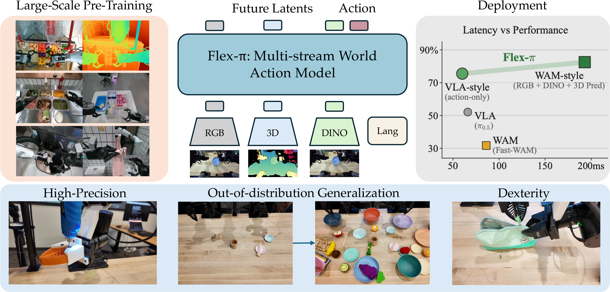

# Flex-π：让同一个世界动作模型按计算预算选择输出流

[论文](https://arxiv.org/abs/2608.10860) · [项目主页](https://flex-pi.github.io/) · [代码](https://github.com/geyan21/flex-pi)

> 这一页回答：动作策略是否必须固定只读 RGB，或者每次都预测完整的未来视觉状态；Flex-π 如何在 RGB、三维几何、语义特征和动作之间共享一个检查点。

Flex-π将世界动作模型（World-Action Model, WAM）做成多流结构，联合去噪当前观测对应的RGB、三维pointmap、物体级DINO语义特征和机器人动作，并通过训练时的流丢弃，让部署者按延迟和效果选取输入/输出组合。它被放在“世界模型VLA与Agent”的“动作生成与通用策略”子类，因为模型输出连续动作块；未来视觉流的预测也构成世界动作建模的一部分。

## 核心图与信号流

> **主要方法图：** 官方仓库提供的论文 teaser，展示 RGB、3D、DINO 和语言输入，经同一 Flex-π 模型产生未来潜变量与动作，并比较 VLA-style 动作模式和 WAM-style 多流模式。来源：[项目资料](https://raw.githubusercontent.com/geyan21/flex-pi/main/assets/flexpi_teaser.png)。

在每个时间步，输入可包括多视角RGB、pointmap、DINO语义patch token、语言指令和本体状态。pointmap由Depth Anything 3根据RGB估计生成，属于模型侧深度估计输入。DINO流编码物体语义特征，触觉和真实物理状态由其他信号提供。视觉latent使用冻结的Wan-2.2 VAE，语言由冻结的umT5编码。模型约6B参数，主体视觉/世界建模部分初始化自Wan-2.2-5B，并配有较轻的动作expert。Mixture-of-Transformers在中间层进行跨流注意力，动作expert读取视觉和条件特征，视觉token不反向读取动作token，以避免动作标签泄漏为视觉预测依据。

## 训练方式与计算弹性

预训练数据约 500 小时，来自 AGIBOT World-Beta 的 100 个任务，记录频率为 30 Hz，包含头部和双腕相机；随后再做任务域微调。RGB、pointmap、DINO 和动作都通过 flow matching 的联合去噪目标训练，论文给出的主损失权重相同，DINO 使用 x-prediction。每个样本以 0.5 的概率独立丢弃视觉输入流，同时至少保留一个视觉流；输出注意力掩码控制动作可以读取哪些未来视觉流，但被省略的输出流仍参与训练。这使一个检查点能够覆盖从 action-only 到完整联合预测的多种模式，项目说明约有 56 种输入/输出组合。

推理时先选择要激活的输入与未来输出流，再进行K步Euler flow sampling。action-only模式只生成动作，适合低延迟控制；WAM-style模式还生成未来RGB、几何和语义latent，代价是更多采样和显存。动作块长度为32；项目和论文报告action-only调用约60 ms，联合模式延迟更高，并在若干任务上带来约13个百分点的性能收益。“计算弹性”体现为推理路径选择，训练参数在运行中保持固定。

## 实验条件与证据

仿真评测覆盖 RoboTwin 2.0 的 50 个任务、LIBERO 四个套件以及 LIBERO-Plus 的七个分布偏移轴；真机使用 YAM 双臂平台，包含 Put Plate on Rack、Sort Utensils、Kitchen Organization、Self-Repair Gripper 和 Soft-Bag Zipping 等五类灵巧操作。论文报告 action-only 与 full-joint 在 LIBERO 上都接近 98% 的成功率，并展示完整多流模式在更高精度、出分布和灵巧任务上的优势。真实任务中的精细间隙、软袋和多阶段修复更能体现未来表示是否提供了额外帮助，但样本仍来自有限机器人和固定任务集合，不能直接外推到任意人形平台。

## 边界与开发建议

Flex-π的未来RGB、pointmap和DINO latent属于模型内部预测表示，描述视觉、几何与语义变化；接触力、摩擦系数和动力学稳定性仍需独立测量或估计。pointmap几何质量受深度估计影响，语言与视觉流联合生成承担表征和预测功能。真机动作通过YAM接口和低层控制执行，碰撞检查、力限幅和急停机制仍由安全控制链负责。延迟和显存数字对应RTX 4090、特定采样步数、流组合和实现细节，不代表所有硬件上的固定控制频率。

<!-- research-navigation:start -->
## 相关研究入口

[世界模型与通用动作策略](../研究方向_世界模型与通用动作策略.md) · [全部论文与技术报告](README.md)
<!-- research-navigation:end -->
