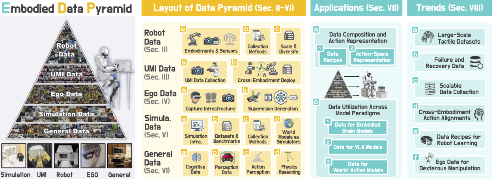

# Data Pyramid：按可扩展性与机器人对齐组织具身操作数据

[论文](https://arxiv.org/abs/2607.24744) · [项目主页](https://jasper-aaa.github.io/embodied-data-pyramid/) · [项目仓库](https://github.com/worldbench/awesome-embodied-data-pyramid)

> 这一页回答：具身操作数据为什么不能只按轨迹数量或小时数比较，以及不同来源进入 VLA、世界动作模型和人形训练前需要补上哪些动作与几何对齐。

Data Pyramid for Embodied Manipulation是一篇综述，把具身操作数据按来源和使用方式组织成五层：真实机器人数据、UMI-style数据、第一视角/第三视角人类数据、仿真数据和通用视觉语言数据。金字塔表达数据组织结构，不提供由底至顶的质量排名；各类数据在质量、多样性、可复用性和物理保真之间有不同取舍。知识库将它放进“动作数据入口与重定向”的“人形训练数据构建”子类，因为综述用统一数据契约讨论来源、采集方式、动作表示和跨本体部署。

## 核心图与五类数据

> **主要方法图：** 官方资源仓库中的 data pyramid overview，对应论文对五类数据源、数据配方和应用方向的组织。来源：[官方资源图](https://raw.githubusercontent.com/worldbench/awesome-embodied-data-pyramid/main/assets/data_pyramid.png)。图中是综述分类和资源索引，不应被当作新数据集的发布图。

金字塔顶层的真实机器人数据通常包含相机、机器人状态和动作，物理保真与机器人对齐最好，但采集昂贵、硬件和本体受限。UMI-style 数据通过可携带的人类操作接口获得相对末端轨迹，降低对目标机器人在线示教的依赖，代价是需要重定向、尺度处理和碰撞检查。第一视角或第三视角人类数据在数量和语义覆盖上有优势，能提供手-物交互和任务分解线索，但多数缺少机器人动作、精确位姿、力觉和可执行轨迹。仿真数据可以规模化生成动作、物体状态、分割和特权动力学标签，却面对渲染偏差、接触模型误差和 sim-to-real。通用视觉语言数据适合补充物体、语言和场景语义，通常与机器人动作和接触物理的距离最远。

## 输入输出与对齐问题

综述强调数据入口要同时记录观察、动作和几何的关系。对真实机器人和UMI数据，需要保存时间戳、相机内外参、机器人本体、末端坐标系、夹爪状态、动作频率和示教接口；对人类视频，需说明视频、手部关键点和深度等标注是否齐全，以及动作采用绝对位姿、相对位移、关节位置还是技能标签。跨本体重定向还要记录末端可达性、关节限位、夹爪语义、接触点和时间尺度。

无动作标签的数据可用于视觉/语言表征、目标识别、轨迹先验或世界模型预训练，再配合机器人对齐数据学习从观测到动作的映射。大量机器人轨迹也可能集中在窄任务、单一本体或成功示范；动作字段齐全本身不能说明数据多样性。Data Pyramid用“可扩展性—机器人对齐”两条轴表达这种张力，并区分action-space alignment与geometric alignment。

## 训练、推理与论文证据

论文分析已有具身大脑、VLA和世界动作模型的数据配方，说明各来源用于表征预训练、动作监督、跨本体迁移或下游微调的方式。综述提供数据表、图表和外部数据链接作为检索与比较入口；算法、统一损失函数、采样器、重定向器、推理API和同预算总榜不属于其贡献范围。

综述指出的数据缺口包括大规模触觉数据、失败与恢复数据、可扩展采集、跨本体动作对齐、灵巧操作的第一视角迁移，以及可解释的数据配方。它们也说明实验条件不能只写“多少小时”：应写清机器人数量、传感器、动作表示、成功/失败比例、场景变化和是否含接触监督。对人形训练尤其要追踪上肢动作与全身状态之间的缺失接口。

## 边界与开发建议

金字塔各层不构成单调质量分级，层级位置不能直接推出泛化性能；同层数据的质量、授权、标定和动作可执行性也可能不同。人类视频映射到机器人动作仍需深度、手物对应、视角转换、接触时序和本体约束；仿真标签与真实摩擦、柔性和传感器噪声之间仍有差异。综述未验证某一种混合比例可在所有VLA或人形模型上达到最优。

<!-- research-navigation:start -->
## 相关研究入口

[动作数据与跨本体迁移](../研究方向_动作数据与跨本体迁移.md) · [全部论文与技术报告](README.md)
<!-- research-navigation:end -->
