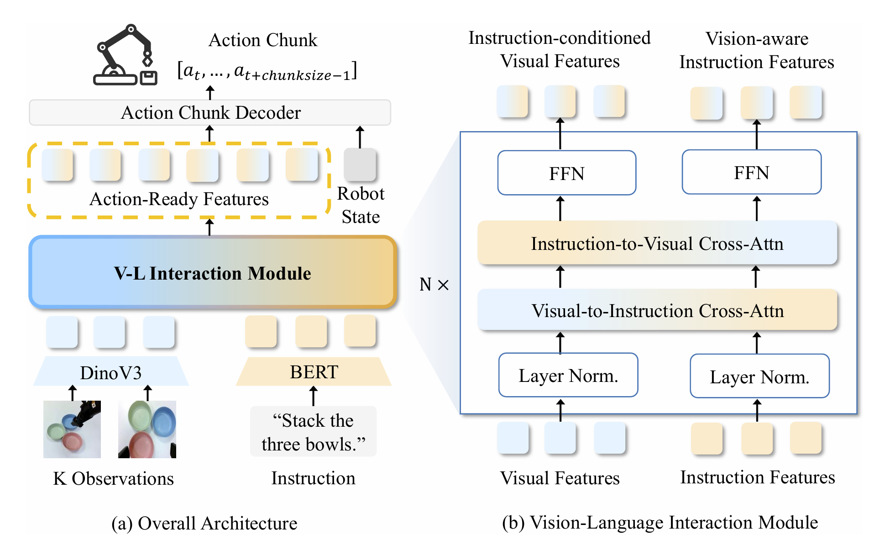

# TurboVLA：把视觉语言直接送入低延迟动作解码器

[论文](https://arxiv.org/abs/2607.27205) · [项目主页](https://h-embodvis.github.io/TurboVLA/) · [代码](https://github.com/H-EmbodVis/TurboVLA)

> 这一页回答：执行级语言指令是否必须经过大语言模型才能得到连续机器人动作，以及 TurboVLA 的低延迟数字具体对应什么输入、输出和硬件条件。

TurboVLA把常见的V→L→A路径改成直接的V+L→A：视觉和语言分别编码，经过轻量的双向视觉语言交互后，由紧凑的ACT-style解码器一次生成连续动作块。它归入“世界模型VLA与Agent”的“动作生成与通用策略”，核心产物是语言条件动作策略；未来场景预测和任务调度由其他系统承担。该模型把执行级语义对齐和动作生成放在较小的在线路径中，适合对响应时间和显存有硬约束的机械臂系统。

## 核心图与输入输出

> **主要方法图：** 官方仓库的 architecture overview，对应论文 Figure 3，展示 DINOv3 视觉编码、BERT 指令编码、双向交叉注意力、机器人状态注入和 action chunk decoder。来源：[官方架构图](https://raw.githubusercontent.com/H-EmbodVis/TurboVLA/main/assets/figures/architecture-overview.png)。

每个时间步的输入是一个或多个相机图像、自然语言指令和当前机器人状态。图像由DINOv3编码，保留空间token，并加入位置与相机视角编码；文本由轻量BERT编码，保留物体、属性和空间关系token；本体状态单独经过投影后送入动作解码器。视觉与语言特征投影到256维共享空间，经6层双向cross-attention：视觉到语言让指令看到当前场景，语言到视觉让目标对象和关系选择相关区域。两路更新后的token与状态一起进入ACT-style transformer，输出H步连续动作块，所有action query并行解码。

## 训练和推理

论文采用行为克隆与 L1 动作损失，不需要额外的语言模型生成目标；实现使用四张 RTX 4090，学习率为 5×10^-5。LIBERO 配置使用 DINOv3 ViT-B、四套件混合训练、7 自由度连续动作和 12 步动作块，训练 80k 步、10k 步 warm-up、有效 batch size 256。RoboTwin 2.0 使用 DINOv3 ViT-L、三路相机、14 维绝对关节位置动作和 50 步 ACT chunk，在干净设置下训练 55k 步、1k 步 warm-up、有效 batch size 192。真机从 LIBERO checkpoint 初始化，再用 4×65 条遥操作示范微调 12.5k 步。

推理流程是相机采样、DINOv3/BERT编码、六层双向交互、状态注入和一次动作块解码；执行若干步后重新观察，形成闭环。论文在单张RTX 4090、batch size 1的口径下报告0.2B参数、31.2 ms端到端策略延迟、0.9 GB推理显存和LIBERO平均97.7%成功率；RoboTwin多任务平均60.2%，对应约43.4 ms。32 Hz表示从多模态观察到产出动作块的策略调用速率，关节、力控回路和相机各自按系统配置运行。

## 实验条件与边界

评测覆盖LIBERO四套件、RoboTwin 2.0的50个双臂任务，并在AgileX Piper单臂平台上测试grab roller、move playing card away、press stapler、stack three bowls四项语言条件操作。真机四项成功率分别为92.5%、80%、90%和87.5%，每项40次，并与相同平台、数据和协议下的π0.5比较。消融显示去掉语言后平均成功率降到70.8%，双向交互在主LIBERO设置达到97.7%，动作horizon从8增到12后改善、继续增大则下降；低延迟取决于具体接口和窗口配置。

TurboVLA面向具体执行级指令，高层规划和长时推理需由其他模块提供。连续动作块表示策略动作输出，关节力矩执行与安全保证由机器人状态接口、轨迹跟踪器、碰撞检查和急停链路承担。32 Hz、31.2 ms和0.9 GB对应RTX 4090、特定模型配置、输入视角、batch size和实现版本；RoboTwin使用的ViT-L配置延迟不同。部署时需核对依赖、相机同步、动作归一化和下游控制器。

<!-- research-navigation:start -->
## 相关研究入口

[世界模型与通用动作策略](../研究方向_世界模型与通用动作策略.md) · [全部论文与技术报告](README.md)
<!-- research-navigation:end -->
